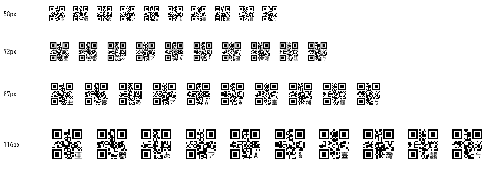

# QR Font

1 字ごとに、その字を記録した QR コードを字形にしたフォントです。QR の右下には、その字そのものを小さく描いています。日本語と繁体字の字を 1 つのフォントに収めています。



- フォント: [fonts/QRFont-Regular.otf](fonts/QRFont-Regular.otf)（OpenType/CFF、ファミリー名 `QR Font`）
- 収録: 13,824 字（下の日本語の字と繁体字の字を合わせたもの。重なる 2,638 字は 1 字として数える）

### 日本語の字（3,275 字）

- ASCII の印字可能文字 94 字（空白は QR にせず、字幅だけの空白）
- ひらがな（ぁ〜ゖ、ゝゞ）、カタカナ（ァ〜ヺ、・ーヽヾ）
- 漢字: 常用漢字（2,136 字）と JIS X 0208 第一水準漢字（2,965 字）を合わせたもの。
  常用漢字表の 𠮟・塡・剝・頰 に対して広く使われている 叱・填・剥・頬 も入れています

### 繁体字の字（13,187 字）

- ASCII の印字可能文字 94 字
- 注音符號（ㄅ〜ㄩ）と声調記号（˙ˉˊˇˋ）の 42 字
- 漢字: Big5 の常用字と次常用字の 13,051 字

### 右下の字形

| 字 | 元フォント |
|---|---|
| 日本語の字（繁体字と重なる 2,638 字を含む） | [BIZ UDゴシック](https://github.com/googlefonts/morisawa-biz-ud-gothic) Regular |
| 繁体字だけにある字（10,549 字） | [台北黑體 Taipei Sans TC Beta](https://bit.ly/jtfoundry) Regular |

重なる字（「骨」「角」など）の右下は日本の字形です。QR の部分は文字コードだけで決まるので、日本語・繁体字のどちらとして使っても同じです。

## QR の形式

| 項目 | 値 |
|---|---|
| 符号化 | UTF-8 のバイトモード（1 字は 1〜4 バイト） |
| 型番 | バージョン 1（21×21 マス） |
| 誤り訂正 | レベル H |
| 余白 | 4 マス（1em = 余白込みで 29×29 マス） |
| 右下の字 | 余白の内側の右下 6×6 マスを白抜きし、字を描く |

右下を白抜きすると、壊れる符号語は 6 個です。レベル H で直せるのは 8 個なので、2 個の余裕が残ります。白抜きを 8×8 マスにすると余裕が 0 になり、9×9 マスでは読めませんでした。

## 使える最小の大きさ

| 1em の大きさ | QR の読み取り（13,824 字中） | 右下の字（目視） |
|---|---|---|
| 29px（1 マス 1px） | 12,850 字 | 読めない |
| 38px（1 マス 1.31px） | 13,380 字 | 読めない |
| 44px（1 マス 1.52px） | 13,823 字（罺 だけ読めない） | 読めない |
| 58px（1 マス 2px） | 全字 | ほぼ読めない |
| 87px（1 マス 3px） | 全字 | 画数の少ない字は読める。鬱・驚・龘のような字は潰れる |
| 116px（1 マス 4px） | 全字 | 画数の多い字もおおむね読める |

- QR だけなら 58px から全字が読めました。58px 以上を勧めます
- 右下の字まで読ませるなら、画数の少ない字で 87px、画数の多い字も含めるなら 116px が最小です
- 1 マスが整数の画素になる大きさ（29 の倍数: 58・87・116px…）で使うと、マスの境目がにじみません
- 読み取りの確認は PC 上の OpenCV（`cv2.QRCodeDetector` と `cv2.QRCodeDetectorAruco`）で行いました。スマートフォンのカメラでの確認はまだです

## 作り方

Python 3 と fontTools・qrcode・opencv-python・Pillow を使います。

1. 元フォントを `source/` に置く
   - [morisawa-biz-ud-gothic](https://github.com/googlefonts/morisawa-biz-ud-gothic) の `fonts/ttf/BIZUDGothic-Regular.ttf`（Version 1.051）
   - [翰字鑄造 JT Foundry](https://bit.ly/jtfoundry) の台北黑體 `TaipeiSansTCBeta-Regular.ttf`（Version 1.000）
2. フォントを作る

```bash
python scripts/build.py
```

テスト（全字のグリフを描いて QR として読み、元の字に戻ることを確かめる）:

```bash
python -m unittest
```

見本画像と大きさごとの読み取り数:

```bash
python scripts/render_sample.py
python scripts/measure_min_size.py 58 87 116
```

## ライセンス

- フォント: [SIL Open Font License 1.1](https://openfontlicense.org)
  - BIZ UDゴシックと台北黑體の改変版です。台北黑體は Source Han Sans の改変版です（[OFL.txt](OFL.txt)）
  - Source Han Sans の予約フォント名「Source」は使っていません
- 生成スクリプトとテスト: [MIT License](LICENSE)
- 常用漢字の一覧（[data/joyo.txt](data/joyo.txt)）は常用漢字表（平成22年内閣告示第2号）の字を表の順に並べたものです。
  ウィキペディア日本語版「常用漢字一覧」の表から字だけを取り出して作りました
- 「QR コード」は株式会社デンソーウェーブの登録商標です
